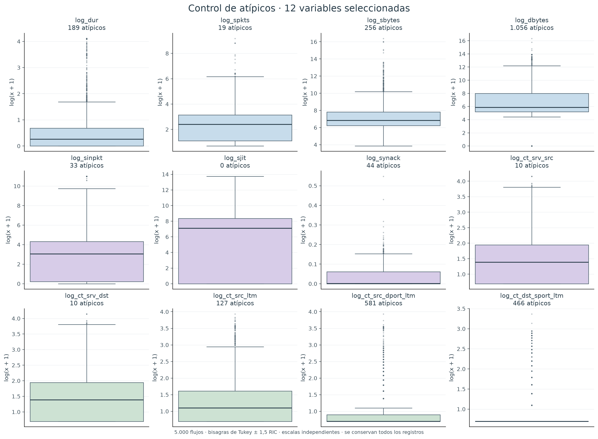
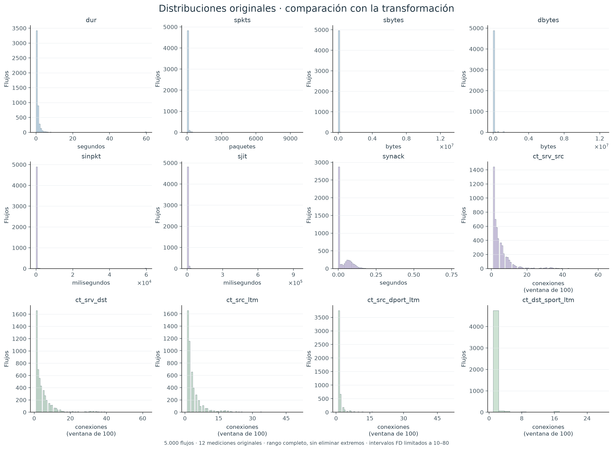
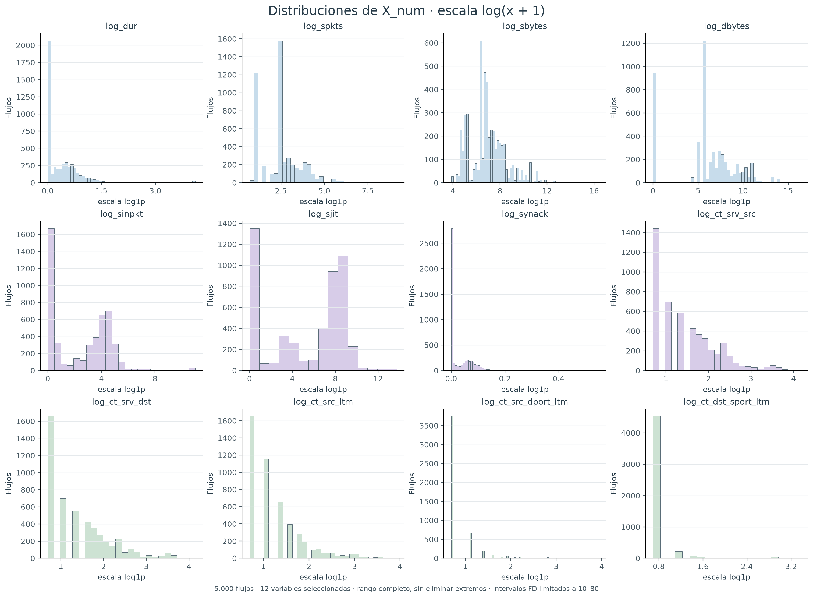
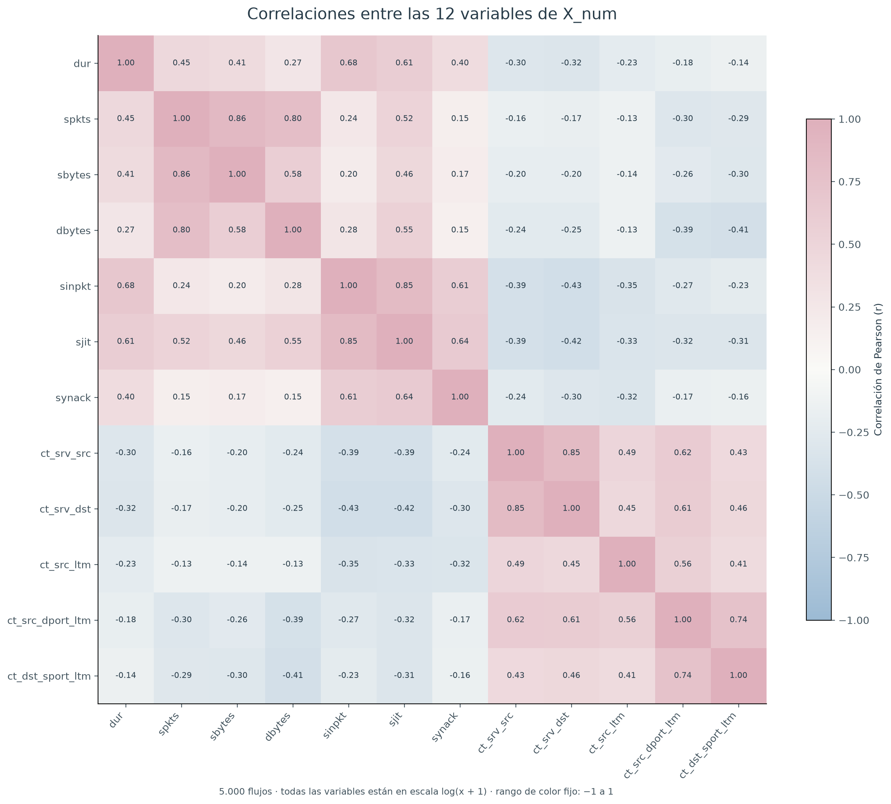
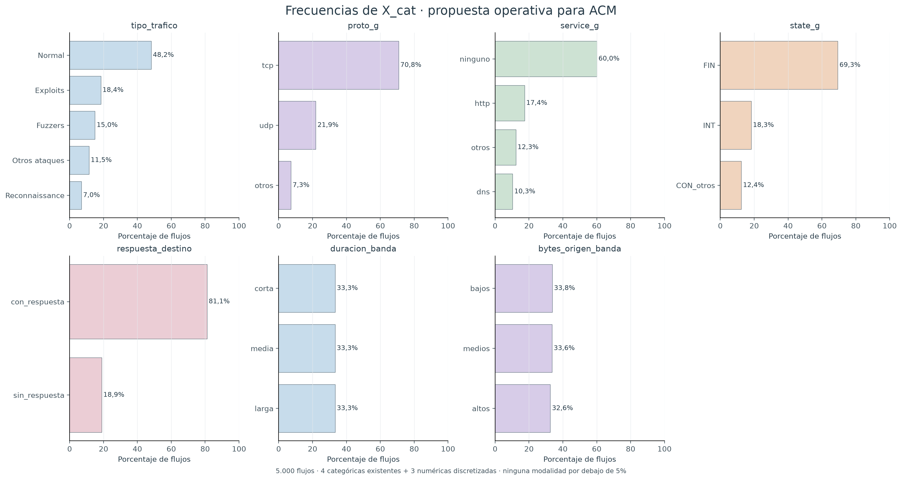
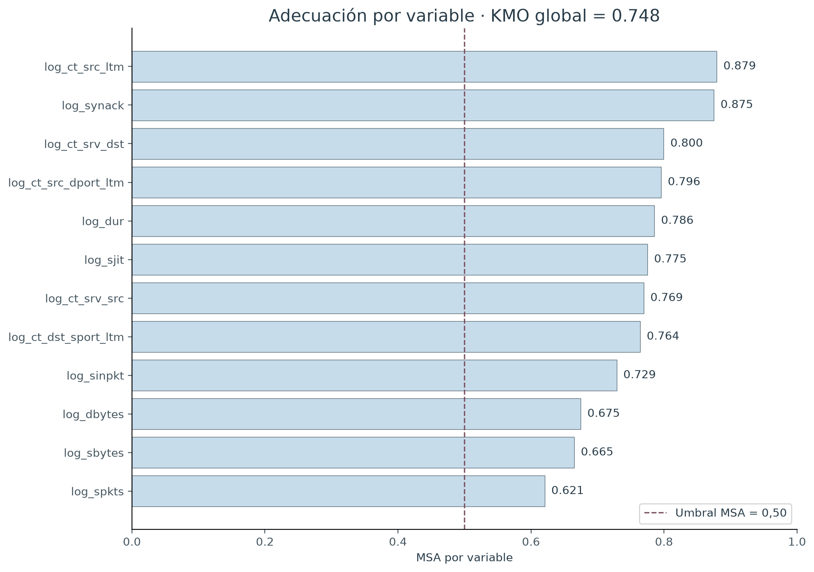

# Datos · Etapa 0: exploración y preparación

## Objetivo, pregunta guía e hipótesis

**Objetivo.** Explorar y preparar los flujos de red, identificar patrones de volumen, tiempo y repetición, y establecer una base común para las técnicas multivariadas y la posterior regresión logística.

**Pregunta guía.** ¿Qué patrones del tráfico de red permiten distinguir flujos normales de ataques y estimar su probabilidad mediante regresión logística?

**Hipótesis de trabajo propuestas:**

1. El número de paquetes y los bytes enviados se relacionan positivamente.
2. Existen grupos de flujos con perfiles diferentes de volumen, tiempos y repetición de conexiones.
3. El tipo de tráfico se asocia con el estado de conexión y la presencia de respuesta del destino.

Estas hipótesis se proponen con conocimiento de la exploración previa de la base; no se presentan como hipótesis registradas antes de observar los datos. Su evaluación completa corresponde a las etapas posteriores y una eventual validación independiente.

## Descripción e importación

UNSW-NB15 es un conjunto de tráfico de red generado en el laboratorio de UNSW Canberra, con actividad normal y ataques sintéticos producidos mediante IXIA PerfectStorm. Cada fila representa un flujo de comunicación. La fuente oficial describe nueve clases de ataques además del tráfico normal. [UNSW, descripción oficial](https://research.unsw.edu.au/projects/unsw-nb15-dataset).

Se trabajó con `muestra_estratificada-simulado-de-ataques.xlsx`, hoja `muestra`: **5.000 flujos y 68 columnas**. La hoja `diccionario` contiene sus definiciones. Según el contexto del proyecto, esta muestra fue obtenida del conjunto de entrenamiento después de la deduplicación y de un muestreo estratificado por `attack_cat`. Esta ejecución parte del Excel recibido; no reconstruye ni verifica de manera independiente ese muestreo anterior.

La importación se realizó en R con `readxl`. Se clasificaron **47 variables numéricas y 21 categóricas** según su significado, no solamente por su almacenamiento. Identificadores, protocolos, servicios, estados y códigos se trataron como categóricos. “Sin unidad” indica que el valor identifica una categoría o código y no una magnitud física; los conteos y las escalas logarítmicas se detallan en el diccionario.

La variable `label` ya está recodificada en el Excel como `normal` y `ataque`: se observaron **2.408 flujos normales (48,16%) y 2.592 ataques (51,84%)**. En una logística futura podrá codificarse normal = 0 y ataque = 1. Las 68 columnas incluyen variables originales, agrupaciones y transformaciones; no equivalen a 68 predictores independientes.

| categoria | frecuencia | porcentaje |
| --- | --- | --- |
| Analysis | 74 | 1,48 |
| Backdoor | 71 | 1,42 |
| DoS | 177 | 3,54 |
| Exploits | 921 | 18,42 |
| Fuzzers | 749 | 14,98 |
| Generic | 194 | 3,88 |
| Normal | 2408 | 48,16 |
| Reconnaissance | 349 | 6,98 |
| Shellcode | 51 | 1,02 |
| Worms | 6 | 0,12 |

## Revisión de calidad y decisiones

No se encontraron valores NA ni textos vacíos, ni duplicados completos, identificadores repetidos o perfiles originales duplicados al excluir `id`. No se imputaron valores ni se eliminaron filas.

Se comprobaron valores negativos, no finitos, conteos no enteros, rangos de TTL y ventanas TCP, conteos de contexto superiores a 100, coherencia básica entre paquetes y bytes, indicadores binarios y correspondencia entre `label` y `attack_cat`. Las reglas y sus resultados se registran a continuación; no constituyen una certificación exhaustiva de toda la semántica de red.

| regla | incidencias |
| --- | --- |
| Celdas numéricas negativas | 0 |
| Celdas numéricas no finitas (sin contar NA) | 0 |
| Conteos no enteros | 0 |
| sttl fuera de 0..255 | 0 |
| dttl fuera de 0..255 | 0 |
| swin fuera de 0..65535 | 0 |
| dwin fuera de 0..65535 | 0 |
| Conteos de ventana de 100 mayores que 100 | 0 |
| dur = 0 con spkts > 1 | 0 |
| sbytes < spkts | 0 |
| usa_http fuera de 0/1 | 0 |
| is_sm_ips_ports fuera de 0/1 | 0 |
| is_ftp_login fuera de 0/1 | 1 |
| label fuera de normal/ataque | 0 |
| Inconsistencia label y attack_cat | 0 |

Se encontró **un caso de `is_ftp_login = 4`, id 97597**, que contradice su definición binaria. Se conserva como código de origen pendiente de revisión, sin recodificarlo ni borrar el flujo. Esta variable queda fuera de X_num y X_cat. Los ceros de variables de respuesta o de tiempos TCP pueden ser estructurales: no se interpretan automáticamente como faltantes. `service = ninguno` también se conserva.

**Atípicos.** Se marcaron valores inferiores a Q1 − 1,5 RIC o superiores a Q3 + 1,5 RIC, con RIC = Q3 − Q1 y Q1/Q3 definidos por las bisagras de Tukey, equivalentes a `fivenum()` de R. Se aplicó el criterio a las 12 variables logarítmicas elegidas. Los cuartiles de la descriptiva usan `quantile(type = 7)` y pueden diferir de las bisagras en datos con empates; las marcas de los boxplots usan siempre Tukey.

La revisión identifica **1715 flujos (34,30%)** con al menos un valor atípico. La columna previa `n_atipicos` identifica **1607 (32,14%)**. Se conserva esa columna sin sobrescribirla: representa un control previo cuya definición completa de variables y límites no está documentada. La revisión actual se registra separadamente. Un valor atípico no prueba un ataque y puede reflejar actividad legítima o un artefacto; **se conservan los 5.000 flujos**. Si el RIC es cero, cualquier valor distinto de las bisagras puede quedar señalado.

*Figura 1. Boxplots con límites de Tukey, en escala log(x + 1); escalas verticales independientes. Fuente: elaboración propia con Matplotlib sobre los resultados de R.*

## Descriptiva

Se calcularon tamaño válido, media, desviación estándar muestral, mínimo, cuartiles, mediana, máximo y proporción de ceros para las 47 variables numéricas. La tabla siguiente resume las 12 mediciones originales elegidas; los resultados completos y sus versiones logarítmicas se incluyen en los CSV del repositorio.

| variable | media | desvio | mediana | maximo |
| --- | --- | --- | --- | --- |
| dur | 1,345 | 5,519 | 0,297 | 59,998 |
| spkts | 32,436 | 227,129 | 10,000 | 9.616,000 |
| sbytes | 16.918,027 | 296.287,457 | 918,000 | 12.965.233,000 |
| dbytes | 26.436,926 | 234.484,461 | 354,000 | 12.422.665,000 |
| sinpkt | 483,532 | 4.778,041 | 19,929 | 60.001,208 |
| sjit | 5.635,756 | 39.960,430 | 1.185,715 | 934.345,666 |
| synack | 0,032 | 0,046 | 0,001 | 0,731 |
| ct_srv_src | 5,087 | 6,326 | 3,000 | 63,000 |
| ct_srv_dst | 4,764 | 6,250 | 3,000 | 62,000 |
| ct_src_ltm | 3,806 | 4,815 | 2,000 | 50,000 |
| ct_src_dport_ltm | 1,949 | 3,344 | 1,000 | 50,000 |
| ct_dst_sport_ltm | 1,416 | 2,036 | 1,000 | 28,000 |

*Figura 2. Histogramas de las 12 mediciones originales. Se conserva el rango completo, por lo que las colas extremas pueden concentrar visualmente las barras cerca de cero.*

*Figura 3. Histogramas de las 12 variables log(x + 1). Los intervalos siguen Freedman–Diaconis con un límite visual de 10 a 80; no se eliminan observaciones.*

En las mediciones originales, la duración media es 1,345 segundos y la mediana 0,297 segundos. Los bytes enviados tienen una media de 16.918,027 y una mediana de 918 bytes. Estas diferencias y las colas de los histogramas muestran que los valores altos afectan a la media, por lo que se interpretan también mediana y cuartiles. Los histogramas permiten comparar la fuerte asimetría de las mediciones originales con su representación logarítmica. La transformación reduce la compresión por valores extremos y conserva los ceros, pero no garantiza normalidad ni elimina todos los valores atípicos.

La matriz de Pearson de X_num muestra asociaciones de volumen, temporización y contexto. Los tres pares con mayor correlación absoluta son: `log_sbytes`–`log_spkts` (r = 0,861); `log_sjit`–`log_sinpkt` (r = 0,851); `log_ct_srv_dst`–`log_ct_srv_src` (r = 0,848). Se trata de asociaciones exploratorias, no de relaciones causales ni de una extracción de factores ya realizada.

*Figura 4. Correlaciones de Pearson entre las 12 variables transformadas, con escala fija de −1 a 1.*

Se obtuvieron tablas de frecuencias absolutas y porcentuales de las 21 variables clasificadas como categóricas, incluyendo identificadores y códigos. Estas tablas completas no implican que todas sean apropiadas para ACM. Para X_cat se proponen las siguientes modalidades:

| variable | categoria | frecuencia | porcentaje |
| --- | --- | --- | --- |
| tipo_trafico | Exploits | 921 | 18,42 |
| tipo_trafico | Fuzzers | 749 | 14,98 |
| tipo_trafico | Normal | 2408 | 48,16 |
| tipo_trafico | Otros ataques | 573 | 11,46 |
| tipo_trafico | Reconnaissance | 349 | 6,98 |
| proto_g | otros | 363 | 7,26 |
| proto_g | tcp | 3541 | 70,82 |
| proto_g | udp | 1096 | 21,92 |
| service_g | dns | 516 | 10,32 |
| service_g | http | 869 | 17,38 |
| service_g | ninguno | 3002 | 60,04 |
| service_g | otros | 613 | 12,26 |
| state_g | CON_otros | 620 | 12,40 |
| state_g | FIN | 3467 | 69,34 |
| state_g | INT | 913 | 18,26 |
| respuesta_destino | con_respuesta | 4055 | 81,10 |
| respuesta_destino | sin_respuesta | 945 | 18,90 |
| duracion_banda | corta | 1667 | 33,34 |
| duracion_banda | larga | 1667 | 33,34 |
| duracion_banda | media | 1666 | 33,32 |
| bytes_origen_banda | altos | 1630 | 32,60 |
| bytes_origen_banda | bajos | 1689 | 33,78 |
| bytes_origen_banda | medios | 1681 | 33,62 |

*Figura 5. Frecuencias de las siete variables propuestas para ACM. Todas las modalidades superan el 5%; no fue necesario volver a agruparlas.*

## Prueba piloto y conjuntos congelados

El piloto se realizó en R con `psych::KMO()` y `psych::cortest.bartlett()`, utilizando la matriz de Pearson de las 12 variables logarítmicas y n = 5.000. El **determinante es 0.00006302**, superior a 0,00001; el **KMO global es 0,748**; Bartlett arroja **χ²(66) = 48.303,53, p < 0,001**. El valor p se informa como desigualdad aunque R lo redondee numéricamente a cero. La MSA mínima es 0,621.

| variable | msa |
| --- | --- |
| log_dur | 0,786 |
| log_spkts | 0,621 |
| log_sbytes | 0,665 |
| log_dbytes | 0,675 |
| log_sinpkt | 0,729 |
| log_sjit | 0,775 |
| log_synack | 0,875 |
| log_ct_srv_src | 0,769 |
| log_ct_srv_dst | 0,800 |
| log_ct_src_ltm | 0,879 |
| log_ct_src_dport_ltm | 0,796 |
| log_ct_dst_sport_ltm | 0,764 |

*Figura 6. MSA por variable y umbral de 0,50.*

Estos indicadores respaldan continuar con ACP y un piloto de AF sin retirar variables del conjunto acordado. No prueban normalidad multivariada, independencia de flujos ni la existencia de un número definitivo de factores. Bartlett es sensible al tamaño de la muestra y sus condiciones inferenciales son aproximadas, en particular porque los conteos de contexto comparten ventanas de conexiones. El determinante se interpreta junto con KMO y MSA, conforme a la consigna. [Documentación KMO](https://personality-project.org/r/psych/help/KMO.html); [Bartlett](https://personality-project.org/r/psych/help/cortest.bartlett.html).

**X_num congelado (decisión previa del grupo):** `log_dur`, `log_spkts`, `log_sbytes`, `log_dbytes`, `log_sinpkt`, `log_sjit`, `log_synack`, `log_ct_srv_src`, `log_ct_srv_dst`, `log_ct_src_ltm`, `log_ct_src_dport_ltm`, `log_ct_dst_sport_ltm`. Son 12 variables, por encima del mínimo de ocho. Se excluyen `dpkts` y `rate` por la redundancia documentada en el contexto del grupo. Tampoco se incluyen identificadores, TTL, `label`, `attack_cat` ni `tipo_trafico`. La estandarización se aplicará en las técnicas posteriores; los archivos comunes guardan los valores logarítmicos sin estandarizar.

**X_cat congelado para reproducibilidad (propuesta operativa pendiente de revisión grupal):** `tipo_trafico`, `proto_g`, `service_g`, `state_g`, `respuesta_destino`, `duracion_banda` y `bytes_origen_banda`. Las cuatro primeras ya existen; las últimas tres se obtienen de `dpkts`, `dur` y `sbytes` respectivamente, fuera de la hoja original. `respuesta_destino` distingue dpkts = 0 y dpkts > 0. Para duración se usan cortes 0,018541000 y 0,709029333 segundos; para bytes de origen, 564,000000 y 1.580,000000 bytes. Los cortes corresponden a los terciles de la muestra (tipo 7), con intervalos cerrados a derecha; los empates pueden producir tamaños distintos de un tercio. Los cortes exactos están guardados para no recalcularlos sobre nuevos datos.

La discretización evita usar la etiqueta de ataque para elegir umbrales. No se incluyen identificadores ni TTL en X_cat. En Etapa 4 se revisará la posible redundancia entre estado y presencia de respuesta, la contribución de protocolos agrupados y el papel activo o suplementario de `tipo_trafico`; cualquier cambio requerirá una versión nueva, no una modificación silenciosa de los archivos congelados. No se han ejecutado ACS, ACM, ACP, AF, clustering ni regresión logística en esta entrega.

## Reproducibilidad y alcance de aprobación

Se fijó `set.seed(42)`. `R/00_datos.R` importa, audita, describe, calcula el piloto, guarda la base común y llama a `python/graficos_etapa0.py`. Todos los gráficos se generaron con Matplotlib, en colores pastel. Se guardaron `datos/base_limpia.rds` y `datos/base_limpia.csv` (5.000 × 68), y `datos/conjuntos_congelados.rds` con los conjuntos y los cortes. La exportación CSV es para intercambio; el RDS conserva los tipos de R. La base original no se altera ni se realiza un nuevo muestreo. Los scripts de las etapas 1 a 4 son plantillas identificadas como pendientes.

Se registraron las versiones de R/Python y los paquetes, la huella del Excel y una comprobación independiente con NumPy de correlaciones, KMO/MSA, Bartlett, bisagras y frecuencias. La base está **preparada para revisión**, con una incidencia FTP documentada fuera de los conjuntos analíticos. La aprobación formal del grupo o la docente queda pendiente; no se afirma que esta automatización la haya otorgado.

## Limitaciones

Los resultados describen una muestra de laboratorio con ataques sintéticos. Según el contexto recibido, se trabaja con perfiles previamente deduplicados y muestreados: las proporciones no son prevalencias operativas de una red real. Las variables de contexto pueden inducir dependencia entre observaciones. Persisten asimetrías, ceros y observaciones extremas aun después de log(x + 1). Las futuras probabilidades logísticas requerirán validación y evaluación de calibración; no se interpretan automáticamente como riesgos reales externos a esta muestra. Las hipótesis y la propuesta X_cat requieren revisión del grupo.

## Anexo: diccionario completo

| nombre | descripcion | unidad | tipo |
| --- | --- | --- | --- |
| id | Identificador del registro dentro de su partición; no identifica equipos. | sin unidad | categórica |
| dur | Duración total del flujo. | segundos | numérica |
| proto | Protocolo de transporte o de red registrado. | sin unidad | categórica |
| service | Servicio identificado; '-' se recodifica como 'ninguno' (sin servicio identificado, no es un faltante). | sin unidad | categórica |
| state | Estado de conexión registrado. | sin unidad | categórica |
| spkts | Paquetes enviados del origen al destino. | paquetes | numérica |
| dpkts | Paquetes enviados del destino al origen. | paquetes | numérica |
| sbytes | Bytes enviados del origen al destino. | bytes | numérica |
| dbytes | Bytes enviados del destino al origen. | bytes | numérica |
| rate | Tasa de paquetes del flujo. | paquetes/segundo | numérica |
| sttl | TTL del origen; se usa agrupado como categórica opcional. | código / valor TTL | categórica |
| dttl | TTL del destino; se reserva como contexto categórico. | código / valor TTL | categórica |
| sload | Carga del origen en bits por segundo. | bits/segundo | numérica |
| dload | Carga del destino en bits por segundo. | bits/segundo | numérica |
| sloss | Paquetes del origen perdidos o retransmitidos. | paquetes | numérica |
| dloss | Paquetes del destino perdidos o retransmitidos. | paquetes | numérica |
| sinpkt | Tiempo entre paquetes del origen. | milisegundos | numérica |
| dinpkt | Tiempo entre paquetes del destino. | milisegundos | numérica |
| sjit | Jitter del origen. | milisegundos | numérica |
| djit | Jitter del destino. | milisegundos | numérica |
| swin | Ventana TCP anunciada por el origen. | bytes | numérica |
| stcpb | Número base de secuencia TCP del origen. | sin unidad | categórica |
| dtcpb | Número base de secuencia TCP del destino. | sin unidad | categórica |
| dwin | Ventana TCP anunciada por el destino. | bytes | numérica |
| tcprtt | Tiempo de establecimiento TCP: synack + ackdat (salvo redondeo decimal). | segundos | numérica |
| synack | Tiempo entre SYN y SYN_ACK. | segundos | numérica |
| ackdat | Tiempo entre SYN_ACK y ACK. | segundos | numérica |
| smean | Tamaño medio de paquetes del origen. | bytes | numérica |
| dmean | Tamaño medio de paquetes del destino. | bytes | numérica |
| trans_depth | Profundidad de transacciones HTTP encadenadas. | transacciones | numérica |
| response_body_len | Longitud sin comprimir del cuerpo de respuesta HTTP. | bytes | numérica |
| ct_srv_src | Conexiones con igual servicio y origen en las últimas 100; conteo, no continua estricta. | conexiones (ventana de 100) | numérica |
| ct_state_ttl | Código de combinación de estado y rango TTL; se agrupa como categórica opcional. | código / valor TTL | categórica |
| ct_dst_ltm | Conexiones con igual destino en las últimas 100. | conexiones (ventana de 100) | numérica |
| ct_src_dport_ltm | Conexiones con igual origen y puerto destino en las últimas 100; conteo, no continua estricta. | conexiones (ventana de 100) | numérica |
| ct_dst_sport_ltm | Conexiones con igual destino y puerto origen en las últimas 100; conteo, no continua estricta. | conexiones (ventana de 100) | numérica |
| ct_dst_src_ltm | Conexiones con igual par origen-destino en las últimas 100. | conexiones (ventana de 100) | numérica |
| is_ftp_login | Indicador nominal de autenticación FTP; se conservan los valores realmente observados. | sin unidad | categórica |
| ct_ftp_cmd | Conteo de flujos con comandos FTP. | flujos FTP | numérica |
| ct_flw_http_mthd | Conteo de flujos con métodos HTTP. | flujos HTTP | numérica |
| ct_src_ltm | Conexiones con igual origen en las últimas 100; conteo, no continua estricta. | conexiones (ventana de 100) | numérica |
| ct_srv_dst | Conexiones con igual servicio y destino en las últimas 100; conteo, no continua estricta. | conexiones (ventana de 100) | numérica |
| is_sm_ips_ports | 1 cuando coinciden IP y puerto entre origen y destino; 0 en otro caso. | sin unidad | categórica |
| attack_cat | Clase original: Normal o uno de los nueve ataques; estratificación y contexto. | sin unidad | categórica |
| label | Respuesta binaria: 0 -> normal; 1 -> ataque; guardada como factor en ese orden. | sin unidad | categórica |
| n_atipicos | Número de variables X_num fuera de los límites 1,5 IQR en log; cortes del training deduplicado. | variables (0 a 14) | numérica |
| tipo_trafico | Normal / Exploits / Fuzzers / Reconnaissance / Otros ataques. 'Otros ataques' agrupa Generic, DoS, Analysis, Backdoor, Shellcode y Worms (cada una < 5 %). | sin unidad | categórica |
| proto_g | Protocolo agrupado: tcp / udp / otros. | sin unidad | categórica |
| service_g | Servicio agrupado: ninguno / http / dns / otros. | sin unidad | categórica |
| state_g | Estado agrupado: FIN / INT / CON_otros. | sin unidad | categórica |
| ttl_origen | TTL de origen: 254 / 31 / otros; opcional; excluida de logística. | sin unidad | categórica |
| perfil_estado_ttl | ct_state_ttl: 0 / 1 / 2_o_mas; opcional; excluida de logística. | sin unidad | categórica |
| repeticion_servicio | ct_srv_src: baja (1-2), media (3-10), alta (>10); suplementaria, posible redundancia ACP/ACM. | sin unidad | categórica |
| usa_http | 1 si service es http o trans_depth > 0; 0 en otro caso; predictor adicional previsto. | sin unidad | categórica |
| log_dur | log1p de dur; conserva ceros; unidad original: segundos. | escala log1p | numérica |
| log_spkts | log1p de spkts; conserva ceros; unidad original: paquetes. | escala log1p | numérica |
| log_dpkts | log1p de dpkts; conserva ceros; unidad original: paquetes. | escala log1p | numérica |
| log_sbytes | log1p de sbytes; conserva ceros; unidad original: bytes. | escala log1p | numérica |
| log_dbytes | log1p de dbytes; conserva ceros; unidad original: bytes. | escala log1p | numérica |
| log_rate | log1p de rate; conserva ceros; unidad original: paquetes/segundo. | escala log1p | numérica |
| log_sinpkt | log1p de sinpkt; conserva ceros; unidad original: milisegundos. | escala log1p | numérica |
| log_sjit | log1p de sjit; conserva ceros; unidad original: milisegundos. | escala log1p | numérica |
| log_synack | log1p de synack; conserva ceros; unidad original: segundos. | escala log1p | numérica |
| log_ct_srv_src | log1p de ct_srv_src; conserva ceros; unidad original: conexiones (ventana de 100). | escala log1p | numérica |
| log_ct_srv_dst | log1p de ct_srv_dst; conserva ceros; unidad original: conexiones (ventana de 100). | escala log1p | numérica |
| log_ct_src_ltm | log1p de ct_src_ltm; conserva ceros; unidad original: conexiones (ventana de 100). | escala log1p | numérica |
| log_ct_src_dport_ltm | log1p de ct_src_dport_ltm; conserva ceros; unidad original: conexiones (ventana de 100). | escala log1p | numérica |
| log_ct_dst_sport_ltm | log1p de ct_dst_sport_ltm; conserva ceros; unidad original: conexiones (ventana de 100). | escala log1p | numérica |

## Referencias

- Moustafa, N., & Slay, J. (2015). UNSW-NB15: a comprehensive data set for network intrusion detection systems. MilCIS, IEEE. https://doi.org/10.1109/MilCIS.2015.7348942
- Moustafa, N., & Slay, J. (2016). The evaluation of Network Anomaly Detection Systems: Statistical analysis of the UNSW-NB15 dataset and the comparison with the KDD99 dataset. Information Security Journal: A Global Perspective, 25(1–3), 18–31. https://doi.org/10.1080/19393555.2015.1125974
- UNSW. The UNSW-NB15 Dataset. https://research.unsw.edu.au/projects/unsw-nb15-dataset (incluye la lista completa de publicaciones que los autores solicitan citar al utilizar el conjunto).
- Revelle, W. Documentación del paquete psych: KMO y cortest.bartlett, enlaces incluidos en el texto. La versión ejecutada se registra en resultados/sesion_R.txt.
